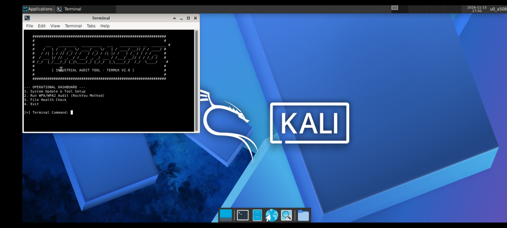
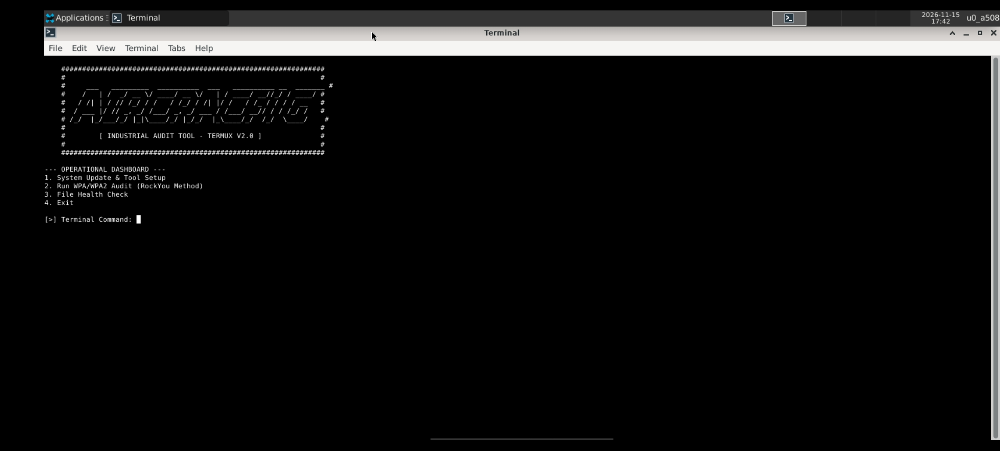

# Aircrack-ng Industrial Audit Tool (Termux V2.0)

A Python wrapper for **aircrack-ng** that runs a WPA/WPA2 audit from a simple terminal dashboard. It works on **Kali Linux**, **Termux (Android)**, and **Windows**.

Repository: https://github.com/johnpaulnunez333-cloud/Aircrack-ng

> ⚠️ **Disclaimer: Educational Purposes Only**
> This project is made strictly for **educational purposes** and **cybersecurity learning**. Use it only on networks and devices that you **own** or have **explicit, written permission** to test. Unauthorized access to wireless networks is illegal in most countries. The author is not responsible for misuse.

## Features

- 📦 Dependency setup (`aircrack-ng`, `python`) from the dashboard (Termux)
- 🔍 File health check for wordlists and `.cap` capture files
- 🔐 WPA/WPA2 audit session using the dictionary method (rockyou.txt)
- ⏱️ Session duration tracking
- 🖥️ Interactive terminal dashboard

## Screenshots

| Screenshot 1 | Screenshot 2 |
|---|---|
|  |  |

## Supported Platforms

| Platform | Python command | aircrack-ng source |
|---|---|---|
| Kali Linux | `python3` | Included in Kali (`sudo apt install aircrack-ng`) |
| Termux (Android) | `python` | `pkg install aircrack-ng` |
| Windows | `python` | Windows build from aircrack-ng.org, added to PATH (or use WSL) |

Python dependencies are listed in [`requirements.txt`](requirements.txt). The script uses only the standard library, so there is nothing to install with pip.

> **Note:** The dashboard option **1 (System Update & Tool Setup)** calls Termux's `pkg` command. On Kali and Windows, install the packages manually using the commands below.

---

## Kali Linux

```bash
sudo apt update
sudo apt install -y aircrack-ng python3
git clone https://github.com/johnpaulnunez333-cloud/Aircrack-ng.git
cd Aircrack-ng
python3 Aircrack-ng.py
```

## Termux (Android)

```bash
pkg update -y
pkg install -y aircrack-ng python
git clone https://github.com/johnpaulnunez333-cloud/Aircrack-ng.git
cd Aircrack-ng
python Aircrack-ng.py
```

Termux can read files in shared storage after you run:

```bash
termux-setup-storage
```

## Windows

1. Install **Python 3** from python.org. Check **"Add Python to PATH"** during installation.
2. Download the aircrack-ng Windows build from https://www.aircrack-ng.org/downloads.html and extract it.
3. Add the folder that contains `aircrack-ng.exe` to your PATH, or run the script from that folder.
4. Open **PowerShell** or **Command Prompt** and run:

```powershell
git clone https://github.com/johnpaulnunez333-cloud/Aircrack-ng.git
cd Aircrack-ng
python Aircrack-ng.py
```

Check that aircrack-ng works first:

```powershell
aircrack-ng --help
```

> **Windows note:** Option 1 in the dashboard uses `pkg` and will not work on Windows. Skip it and install aircrack-ng manually as shown above.

Alternatively, use **WSL** (Windows Subsystem for Linux) and follow the Kali Linux steps.

---

## Usage

Dashboard options:

1. **System Update & Tool Setup** — installs or updates the required packages (Termux only)
2. **Run WPA/WPA2 Audit (RockYou Method)** — runs `aircrack-ng` against a `.cap` file and a wordlist
3. **File Health Check** — checks that a file exists and shows its size
4. **Exit**

### Example

```bash
[>] Terminal Command: 2
[Input] Path to .cap file: /sdcard/captures/handshake.cap
[Input] Path to rockyou.txt: /sdcard/wordlists/rockyou.txt
```

On Kali, the wordlist is usually at `/usr/share/wordlists/rockyou.txt` (unzip `rockyou.txt.gz` first if needed).

## Legal & Ethical Use

This project is for **learning and authorized cybersecurity testing** only, such as testing your own lab network or a network you have written permission to audit. Follow your local laws.

## License

For educational use. No warranty is provided.
